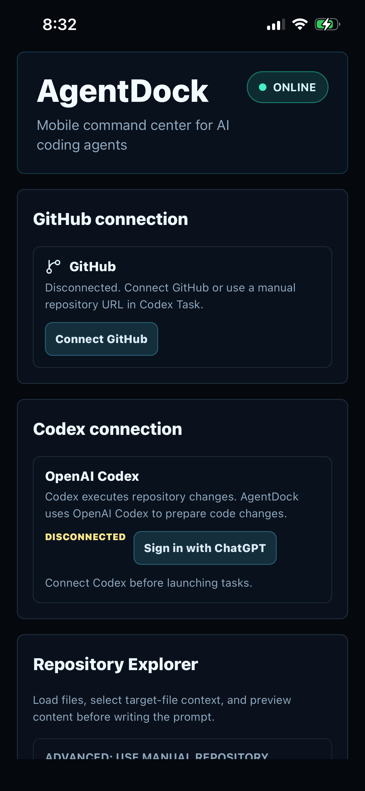
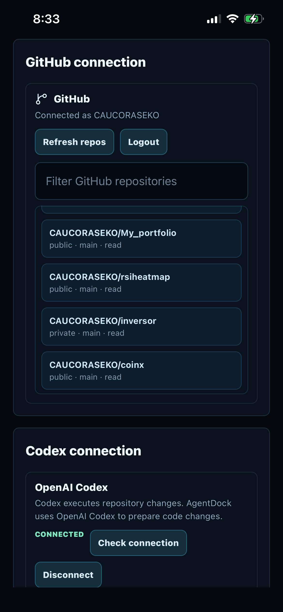
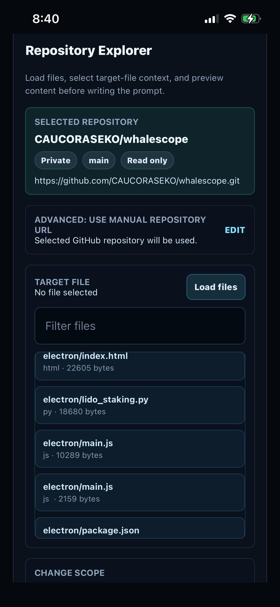
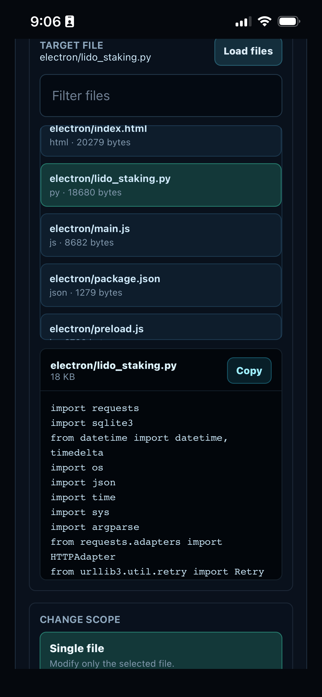
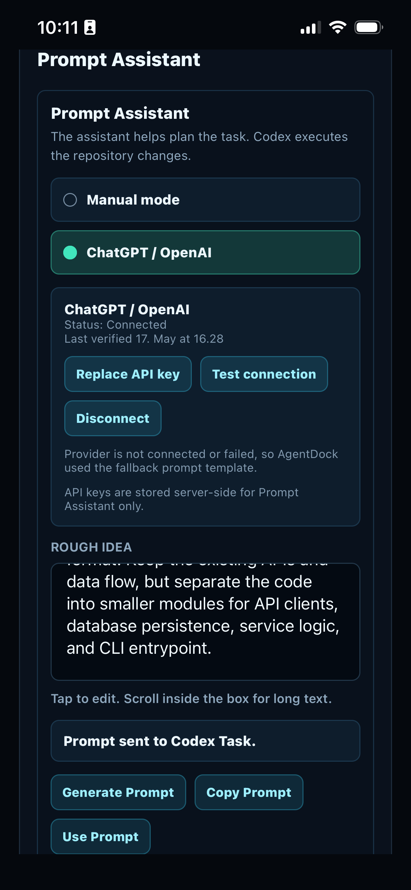
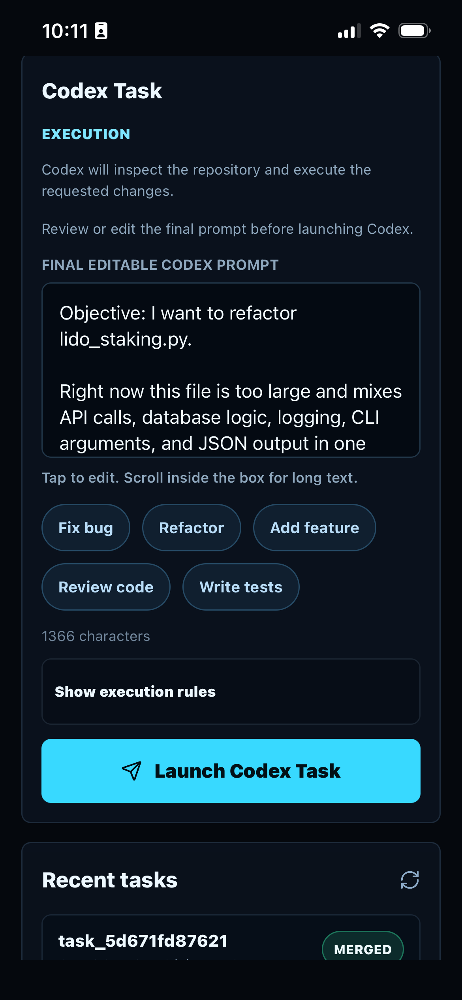

# AgentDock

AgentDock is a mobile command center for AI coding agents.

It gives developers a lightweight interface for starting, guiding, reviewing, and shipping AI-assisted coding work from a phone or web panel. AgentDock is not a mobile IDE. It is an orchestration layer around repositories, agent sessions, diffs, approvals, commits, and pull requests.

## Product Overview

AgentDock coordinates the operational parts of agentic development:

- Connect to GitHub repositories.
- Create isolated workspaces for coding tasks.
- Start Codex-backed implementation sessions.
- Use a Prompt Assistant to refine task instructions before execution.
- Review generated diffs before committing.
- Commit, push, open pull requests, and merge through an explicit approval flow.

The goal is to keep the developer in control while reducing the amount of laptop-bound work required to manage coding agents.

## Core Workflow

```text
GitHub
  -> Codex
  -> Prompt Assistant
  -> Diff
  -> Commit
  -> Push
  -> PR
  -> Merge
```

In practice:

1. Select a GitHub repository.
2. Create a task with a clear objective.
3. AgentDock prepares a workspace and branch.
4. Codex runs the implementation task.
5. Prompt Assistant helps clarify or improve instructions where needed.
6. AgentDock presents the resulting diff.
7. The developer approves the changes.
8. AgentDock commits and pushes to the working branch.
9. AgentDock opens a pull request.
10. The pull request can be merged after review.

## Current Features

- FastAPI backend for task orchestration.
- Expo mobile app shell for the command center interface.
- Vite React frontend for local web use.
- GitHub repository browsing and authentication support.
- GitHub App configuration path, with OAuth fallback for local development.
- Task creation and persistence.
- Workspace and branch management.
- Diff generation.
- Approval workflow for generated changes.
- Commit, push, pull request, and merge controls behind safety flags.
- Prompt Assistant provider support.
- Mock, local, and Codex-oriented agent runner configuration.
- Backend test coverage for task storage, GitHub integration, agent providers, Prompt Assistant, repo browsing, and approval workflow.

## Repository Structure

```text
AgentDock/
  backend/      FastAPI API, task orchestration, GitHub, agents, diffs
  mobile/       Expo / React Native mobile client
  frontend/     Vite / React web client
  docker/       Worker image scaffold
  docs/         Architecture and roadmap notes
  scripts/      Development helper scripts
```

## Local Setup

### Prerequisites

- Python 3.11
- Node.js and npm
- Git
- Optional: Codex CLI, if running real Codex tasks locally
- Optional: GitHub App or OAuth credentials, if testing authenticated GitHub flows

### Backend

```bash
cd backend
python3.11 -m venv .venv
source .venv/bin/activate
pip install -r requirements.txt
cp .env.example .env
python -m uvicorn app.main:app --reload
```

The API defaults to `http://127.0.0.1:8000`.

You can also start the backend from the repository root:

```bash
./scripts/dev_backend.sh
```

### Mobile App

```bash
cd mobile
npm install
cp .env.example .env
npm run start
```

Set `EXPO_PUBLIC_AGENTDOCK_API_URL` to the backend URL reachable from the device or simulator.

### Web Frontend

```bash
cd frontend
npm install
cp .env.example .env
npm run dev
```

Set `VITE_AGENTDOCK_API_URL` to the backend URL.

## Required Environment Variables

Backend configuration lives in `backend/.env`. Start from `backend/.env.example`.

### Core Backend

```env
APP_NAME=AgentDock
APP_ENV=development
APP_DEBUG=true
API_HOST=127.0.0.1
API_PORT=8000
WORKSPACES_DIR=./workspaces
LOGS_DIR=./logs
AGENTDOCK_DB_PATH=./data/agentdock.sqlite3
```

### GitHub

For production-like GitHub integration, configure a GitHub App:

```env
GITHUB_APP_ID=
GITHUB_APP_SLUG=
GITHUB_APP_PRIVATE_KEY_PATH=
GITHUB_APP_CLIENT_ID=
GITHUB_APP_CLIENT_SECRET=
GITHUB_APP_INSTALL_URL=
GITHUB_APP_CALLBACK_URL=http://127.0.0.1:8000/auth/github-app/callback
GITHUB_PR_MERGE_METHOD=squash
DELETE_BRANCH_AFTER_MERGE=false
```

For local development, the backend also supports fallback token or OAuth configuration:

```env
GITHUB_TOKEN=
GITHUB_OWNER=
GITHUB_DEFAULT_BRANCH=main
GITHUB_OAUTH_CLIENT_ID=
GITHUB_OAUTH_CLIENT_SECRET=
GITHUB_OAUTH_REDIRECT_URI=http://127.0.0.1:8000/auth/github/callback
```

### Prompt Assistant And Agent Providers

```env
AI_PROVIDER=mock
OPENAI_API_KEY=
ANTHROPIC_API_KEY=
PROMPT_ASSISTANT_OPENAI_MODEL=gpt-5.5
PROMPT_ASSISTANT_ANTHROPIC_MODEL=claude-sonnet-4-5
```

Use `AI_PROVIDER=mock` for local development without external model calls.

### Codex And Local Runner

```env
AGENT_RUNNER=mock
CODEX_CLI_COMMAND=codex
CODEX_ENABLED=false
CODEX_TIMEOUT_SECONDS=900
LOCAL_RUNNER_COMMAND=
LOCAL_RUNNER_TIMEOUT_SECONDS=900
```

Use `AGENT_RUNNER=mock` for local UI and workflow testing. Use the local or Codex runner only in an environment prepared for agent execution.

### Safety Flags

```env
ALLOW_PUSH=false
ALLOW_PR_CREATION=false
MAX_TASK_RUNTIME_SECONDS=900
```

Keep push and pull request creation disabled until credentials and repository permissions are configured intentionally.

### Client Apps

Mobile:

```env
EXPO_PUBLIC_AGENTDOCK_API_URL=http://127.0.0.1:8000
```

Web:

```env
VITE_AGENTDOCK_API_URL=http://127.0.0.1:8000
```

## Development Commands

From the repository root:

```bash
./scripts/check_project.sh
./scripts/dev_backend.sh
```

Backend:

```bash
cd backend
source .venv/bin/activate
python -m uvicorn app.main:app --reload
python -m pytest
```

Mobile:

```bash
cd mobile
npm run start
npm run ios
npm run android
npm run web
```

Web frontend:

```bash
cd frontend
npm run dev
npm run build
npm run lint
npm run preview
```

## Screenshots

### Initial application state



### GitHub and Codex connected



### Repository Explorer



### File Preview And Selection



### Prompt Assistant — Compact Scrollable Idea Input



### Codex Task — Final Editable Prompt Flow




Suggested placeholders:

- Repository selection
- Task creation
- Prompt Assistant
- Diff review
- Approval and pull request status

## Security Notes

- API keys and GitHub credentials stay backend-side.
- Mobile and web clients should call AgentDock APIs, not provider APIs directly.
- Codex authentication is separate from Prompt Assistant provider keys.
- Prompt Assistant keys configure model calls used to refine or support task instructions.
- Codex CLI authentication is owned by the backend or worker runtime used to execute coding tasks.
- Generated changes are shown as diffs before commit.
- Push, pull request creation, and merge behavior are gated by backend configuration and approval flow.
- Workspaces should be treated as isolated execution environments and cleaned up according to deployment policy.

## Roadmap v0.2

- Complete mobile-first task workflow from repository selection through pull request.
- Improve Codex session lifecycle management.
- Add richer Prompt Assistant controls for task clarification and iteration.
- Add task logs and execution status streaming.
- Add test command configuration per repository.
- Improve diff review ergonomics on mobile.
- Add notification hooks for task completion and review requests.
- Add team approval and policy controls.
- Harden workspace isolation and cleanup.
- Expand provider support after the core workflow is stable.

## Development Status

AgentDock is in early product development. The repository contains the core backend workflow, client shells, and tests for the main orchestration paths. The project is still evolving, and safety defaults are intentionally conservative.

## License

TBD
